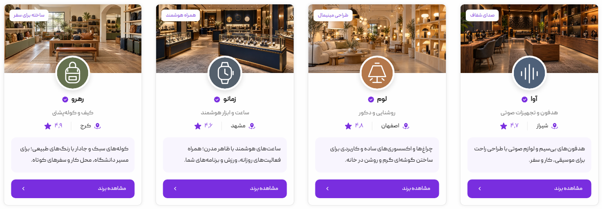

# Shoppie — Persian marketplace

A responsive RTL marketplace frontend built with Next.js App Router, React, strict TypeScript, and SCSS. It combines the original custom design with product, tour, property, shop, and account flows.



## Local development

Use Node.js 22 or newer and npm. No environment variables or database are required for local development.

```sh
npm ci
npm run dev
```

Open http://localhost:3000. The route explorer at /explore provides access to the migrated screens.

## What works

- Responsive Persian layouts, local Peyda fonts, and desktop/mobile navigation.
- Product, tour and property detail routes, image enlargement, related cards and connected home sections.
- Shared category listings with client-side text, category, city and price filters, sorting, result counts and empty states.
- One shared location picker with staged scope/province/city selection, keyboard dismissal and focus restoration.
- Multi-step listing/shop forms, upload previews, local drafts, review screens and compact validation notices.
- Account hub, verification steps, local chat conversations, wallet and booking interfaces.
- Pointer-driven ring carousel with inertia and reduced-motion support.

## Scope

This is a frontend portfolio application. Catalogs, account information and financial amounts are local fixtures. Login does not authenticate, chats do not send messages to a server, and payments, identity checks, publishing and bookings do not perform external transactions. Form drafts may persist in the current browser; uploaded previews are local and must be reselected after reload.

## Main routes

| Route                                               | Purpose                |
| --------------------------------------------------- | ---------------------- |
| /                                                   | Storefront             |
| /inner-category/products-category                   | Products               |
| /inner-category/products-category?type=tours        | Tours                  |
| /inner-category/house-category                      | Houses and villas      |
| /inner-category/online-shops-category               | Online shops           |
| /inner-category/brands-category                     | Brands                 |
| /inner-category/hire-ads-category                   | Jobs                   |
| /search-result?q=…                                  | Product search         |
| /products/[slug], /tours/[slug], /properties/[slug] | Detail pages           |
| /account                                            | Responsive account hub |
| /create-products/add-personal-product               | Listing creation       |

## Code organization

```text
src/app/                   Route entry points and metadata
src/components/catalog/    Shared category shell, filters and cards
src/components/layout/     Shared chrome, navigation and location state
src/components/home/       Storefront sections
src/components/forms/      Staged forms, validation and draft behavior
src/components/account/    Account interactions
src/hooks/                 Shared dismiss and modal focus behavior
src/data/                  Typed local fixtures
src/lib/                   Formatting and carousel behavior
styles/                    Original SCSS design system
public/assets/             Runtime fonts, images and icons
legacy/pages/              Original HTML references
 tests/                    Browser regression checks
```

Route files compose components; interactive state belongs to the component that owns it. The remaining migration adapter in site-interactions.tsx supports legacy mobile search and header controls. See [architecture notes](docs/architecture.md) for the boundary and conventions.

## Quality checks

```sh
npm run typecheck
npm run format:check
npm run build
npm test
```

Browser checks use a production server on port 3100. Local runs use installed Google Chrome; CI uses Playwright Chromium. Reports and failure traces are written to playwright-report and test-results. Run npm run test:ui for interactive debugging after building.

## Assets and attribution

The original design and HTML/SCSS implementation are preserved in the source references. Generated product and storefront photographs are documented in docs/*prompts.json; runtime derivatives live in public/assets/images. Account outline icons are from Lucide, with their license in public/assets/svg/account/LICENSE. Do not rerun the one-time migration scripts during normal development: they can overwrite subsequent work.

## Deployment

Run npm run build and npm start on a Node.js host, or deploy the repository with a Next.js-compatible host. Set `NEXT_PUBLIC_SITE_URL` to the public HTTPS origin so social preview image URLs resolve correctly. Deployment of this frontend does not add backend functionality.

## License

This project is licensed under the MIT License; see [LICENSE](LICENSE). Third-party assets retain their respective licenses.
